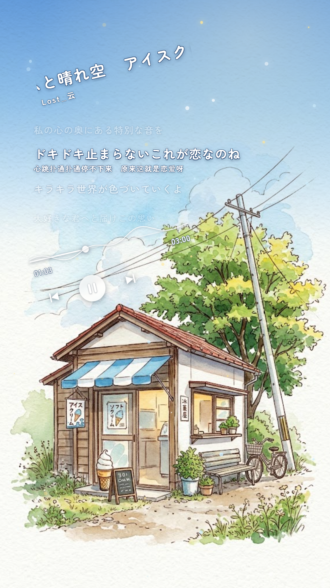

# Anime Lyric Player MV Engine (日系美学手书与歌词视频生成引擎)

<p align="center">
  
</p>

<p align="center">
  <a href="https://remotion.dev"></a>
  <a href="https://react.dev"></a>
  <a href="https://www.typescriptlang.org/"></a>
  <a href="LICENSE"></a>
</p>

[English](README.md) · [简体中文](README-ZH.md)

---

## 🌟 Overview (项目简介)

**Anime Lyric Player MV Engine** is an open-source, programmable music video rendering engine built on **Remotion, React, and TypeScript**. 

It generates high-aesthetic Japanese anime-style **9:16 vertical lyric player videos** and **16:9 widescreen watercolor montages** with:
- **-13° Tilted Aesthetic Music Player UI** (`< || >`, progress bar, and playhead).
- **Smooth Spring-Interpolated Scrolling Lyrics** (Japanese original + localized translation).
- **Dynamic SVG Audio Wave Ribbon** driven by real-time audio RMS energy envelopes.
- **Cute Japanese Typography**: Bundled with **Zen Maru Gothic (禅丸黑体)** rounded fonts and soft sticker-rim shaders.
- **Sunny Azure Watercolor Sky Wash**: Day-lit anime sky gradients that multiply into watercolor paper textures without dark/night dimming.
- **Turnkey Automation Pipeline**: CLI tools to process raw `.mp3` and `.lrc` files into ready-to-render Remotion compositions in seconds.

---

## 📸 Visual Showcase (视觉呈现)

| 9:16 Vertical Lyric Player MV (`VerticalPlayerMV`) | 16:9 Widescreen Watercolor MV (`IceCreamMV`) |
| :---: | :---: |
|  | 1920×1080 Multi-Window Cinematic Montage |
| *Tilted marquee, Zen Maru Gothic lyrics, live audio wave* | *Watercolor framing, living baseline & camera breathing* |

---

## ✨ Key Features (核心亮点)

1. **Zen Maru Gothic Anime Typography (可爱日系圆体与贴纸描边)**
   - Custom Japanese anime rounded font `Zen Maru Gothic` bundled offline in `public/fonts/`.
   - Dual-layer sticker shadow shader (`text-shadow`) prevents text eat-in on bright clouds while preserving a soft stationery look.

2. **Sunny Azure Sky Wash (盛夏晴空蔚蓝水彩晕染)**
   - Uses CSS `mix-blend-mode: multiply` to naturally bloom vibrant summer blue into watercolor paper fibers.
   - 100% daytime sunlight feel, perfectly matching songs titled *Clear Sky (晴れ空)*.

3. **Audio-Driven Visualizer (真音频能量包络驱动)**
   - Python-based 30fps RMS extraction (`scripts/extract_audio_envelope.py`) produces sub-frame amplitude data.
   - SVG multi-harmonic sine waves respond organically to rhythm and vocal intensity.

4. **One-Command CLI Pipeline (自动化范式流水线)**
   - Swap in your own song, background illustration, and LRC lyrics in a single CLI command.

---

## 🚀 Quick Start (快速上手)

### 1. Prerequisites
- **Node.js**: >= 18.0.0
- **Python**: >= 3.8 (for audio envelope extraction)
- **FFmpeg**: (optional, for audio decoding fallback)

### 2. Installation
```bash
# Clone the repository
git clone https://github.com/liliqqtu/music.git
cd music

# Install dependencies
npm install
```

### 3. Preview in Studio
Launch the interactive Remotion Studio web interface:
```bash
npm run dev
# or
npm start
```
Visit `http://localhost:3000` to preview and scrub the timeline in real time.

### 4. Render Video
```bash
# Render 9:16 Vertical Lyric Player MV (1080x1920 @ 30fps)
npm run render:vertical

# Render 16:9 Widescreen Watercolor MV (1920x1080 @ 30fps)
npm run render:widescreen

# Render a still preview frame (Frame 1900)
npm run still
```

---

## 🛠️ Automation Pipeline (一键范式流水线)

Use `scripts/render_pipeline.py` to produce a new music video with your own assets:

```bash
python scripts/render_pipeline.py \
  --audio "path/to/song.mp3" \
  --bg "path/to/illustration.jpg" \
  --lrc "path/to/lyrics.lrc" \
  --zh "path/to/translation.txt" \
  --mode vertical \
  --out "out/my_lyric_video.mp4"
```

The pipeline automatically:
1. Calculates frame-by-frame audio RMS amplitude data into `src/data/audio-envelope.json`.
2. Parses LRC timestamps and aligns bilingual lines into `src/data/lyrics.ts`.
3. Invokes the headless Remotion Chrome compiler to output the finished 1080x1920 MP4 video.

---

## 📂 Project Structure (项目目录规范)

```text
music/
├── docs/                      # Documentation & showcase assets
│   └── images/
│       └── preview_vertical.png
├── public/                    # Static runtime assets served by Remotion
│   ├── assets/
│   │   └── scenes/            # Background illustrations (.jpg)
│   ├── audio/                 # Soundtrack audio (.mp3)
│   └── fonts/                 # Zen Maru Gothic TTF font files
├── scripts/                   # Python automation tools
│   ├── extract_audio_envelope.py  # Audio RMS analyzer
│   ├── parse_lrc.py               # LRC & translation parser
│   └── render_pipeline.py         # One-click end-to-end pipeline
├── src/                       # Remotion React codebase
│   ├── components/            # Visual components
│   │   ├── AudioWaveRibbon.tsx       # Dynamic audio wave ribbon
│   │   ├── MarqueeTitle.tsx          # -13° tilted marquee title
│   │   ├── ScrollingLyricsPlayer.tsx # Smooth spring scrolling lyrics
│   │   ├── SunlightParticles.tsx     # Sunlight bokeh & dust particles
│   │   ├── TiltedMusicPlayer.tsx     # -13° tilted music player UI
│   │   └── VerticalBackground.tsx    # Ken Burns camera & azure sky wash
│   ├── data/                  # Precomputed data
│   │   ├── audio-envelope.json       # RMS energy envelope
│   │   └── lyrics.ts                 # Timestamped lyrics dataset
│   ├── IceCreamMV.tsx         # 16:9 widescreen composition
│   ├── VerticalPlayerMV.tsx   # 9:16 vertical player composition
│   ├── Root.tsx               # Remotion root registration
│   └── index.ts               # Remotion entry point
├── .gitignore
├── LICENSE                    # MIT License
├── package.json
├── remotion.config.ts
└── tsconfig.json
```

---

## 📄 License

This project is licensed under the [MIT License](LICENSE).

Art and audio assets are for demonstration purposes. Fonts (`Zen Maru Gothic`) are licensed under the [SIL Open Font License 1.1](https://scripts.sil.org/OFL).
